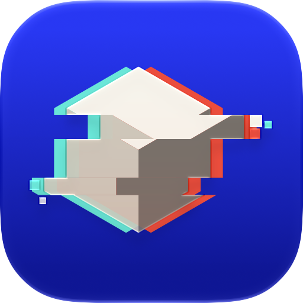
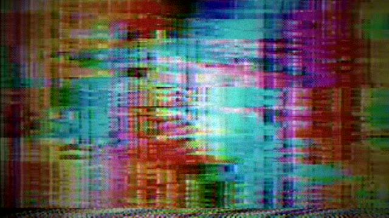
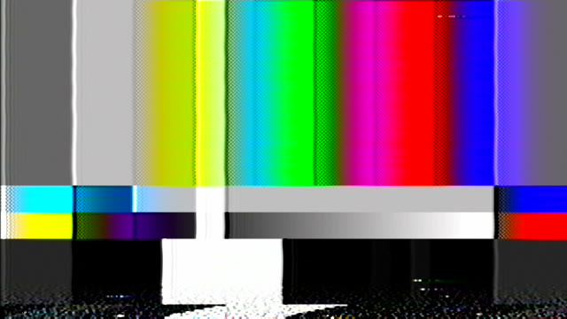
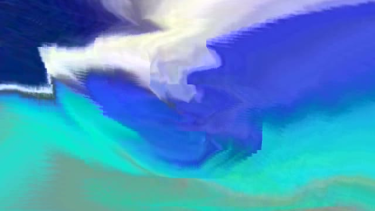
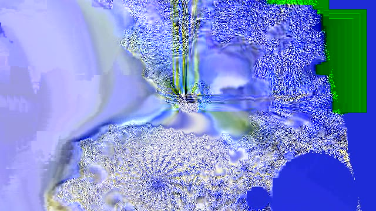
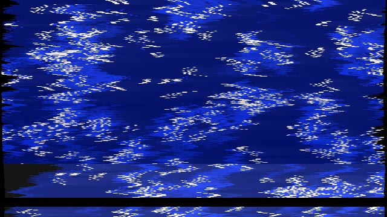
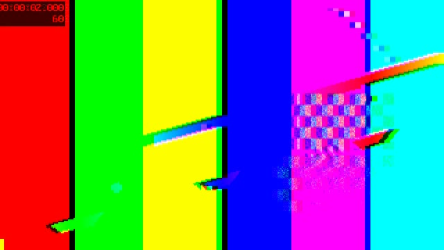
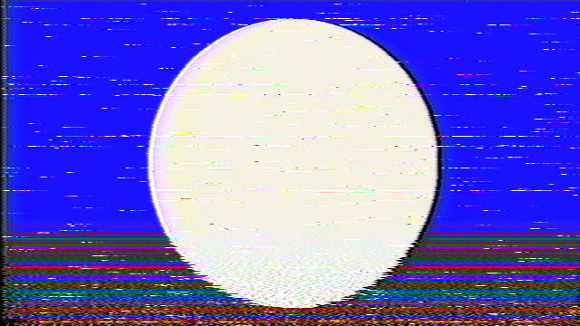

<p align="center">
  
</p>

<h1 align="center">Glitchbox</h1>

<p align="center">Break video on purpose.</p>

<p align="center">
  
</p>

Glitchbox is a Mac app for wrecking video in ways that look intentional. Stack
datamosh, VHS tape damage, circuit-bent video hardware, and pixel-level effects
into a chain, turn the knobs on each layer, and watch the result in the built-in
player. Every tool it runs ships inside the app, so there's no Homebrew setup and
no FFmpeg fork to compile.

**[Download Glitchbox for macOS](https://github.com/kylegrantlucas/glitchbox/releases/latest)** · Apple silicon, macOS 26 or later

## What it does

### Effects in layers

A chain is a stack of layers, and every layer is one effect with its own
controls. Add, reorder, switch off, and remove layers, then render. Work on a
few seconds at a small size while you dial it in, then render the whole clip at
its own resolution. The frame rate can follow the source or be any of the
standard rates, NTSC ones included.

### Only the part you changed renders again

Every layer's output is cached. Nudge a slider on the third layer and Glitchbox
re-renders that layer and the ones below it, while everything above comes
straight from the cache. Layers hand each other lossless video, so stacking them
adds no extra compression in between.

### Export

Export the finished chain as H.264 or HEVC, ProRes from 422 LT up to 4444,
lossless FFV1, an animated GIF, or a folder of PNG frames. Keep the clip's own
audio, swap in another track, or leave it silent. Resize on the way out to a
set height, a custom frame, or a 9:16, 1:1, or 4:5 crop for social posts.
Changing export settings never re-renders the chain, and the frame under the
playhead can be saved as a PNG.

### Presets for chains and for single effects

Save a whole stack as a chain preset, or save one layer's settings as a preset
for that effect. Two effects come with presets: the MPEG-2 mosh has long smear,
pan drift, and sink and rise, and the circuit-bend effect brings every preset
that ships with bender. If you edit a built-in preset, your copy replaces it
until you revert it.

### Your own effects

An effect is a small JSON file that declares its parameters and the commands to
run, and Glitchbox builds the controls from it. Write one in the app's plugin
editor or by hand. Steps can call any of the bundled tools, and a step can be a
whole bash script that gets every parameter as a variable.

### A command line, too

The app carries a `glitchbox` command that uses the same engine, effects, and
cache, so a chain you saved in the app renders and exports headless:

```sh
glitchbox export --chain analog-mosh-vhs --format prores -o clip-vhs.mov clip.mp4
```

## The effects

Every clip below is a real Glitchbox render of one of ffmpeg's built-in test
generators.

| | | |
|:---:|:---:|:---:|
| <br>VHS dub (analog pass) | <br>Long smear (MPEG-2 mosh) | <br>Zoom in, zoom out (MV script) |
| <br>Rolling tear (circuit bend) | <br>Smeared test card (pixel smear, RGB split) | <br>Kick drum on the tracking (Reactive VCR) |

Nineteen effects come built in.

### Datamosh

MPEG-2 Mosh encodes your clip with forced motion vectors and then smears them,
with an averaging window, separate horizontal and vertical scale, and drift. MV
Script runs the deterministic DD-GlitchAssist scripts on the same encode, and MV
Mangle shuffles MPEG-4 motion vectors from a seed. All three run on
[FFglitch](https://ffglitch.org).

### Analog video

Analog Pass is a full NTSC and VHS simulation from
[ntsc-rs](https://github.com/valadaptive/ntsc-rs), with every one of its settings
exposed. Reactive VCR drives those artifacts from audio, either the clip's own
soundtrack or a file you choose. Its default mapping lets the bass push tracking
noise and sharp hits trigger head switching. VHS Filter is a lighter ffmpeg take
with levels, misregistration, noise, softness, and vignette.

### Circuit bending

Circuit Bend runs your clip through emulated video hardware from
[bender-rs](https://github.com/kylegrantlucas/bender-rs): camera sensor, tape,
frame store, colour encoder, monitor, and feedback loop. Any stage can be broken
the way a stray wire would break it, and you can put the stages in a different
order.

### Pixel effects

RGB Split, Pixel Smear (pixel-sort-style streaks), Pixelate, Bitcrush, Trails,
Frame Blend, and Datascope come from ffmpeg. Block Glitch, Row Shift, Plasma
Distort, Kaleidoscope, and Vertigo come from frei0r.

## Install

Download `Glitchbox-<version>.dmg` from
[Releases](https://github.com/kylegrantlucas/glitchbox/releases/latest), open it,
and drag Glitchbox to Applications. It needs a Mac with Apple silicon and macOS
26 or later, and takes about 195 MB on disk.

Glitchbox isn't notarized yet, so macOS blocks the first launch. Open System
Settings → Privacy & Security and click Open Anyway, or clear the quarantine flag
in Terminal:

```sh
xattr -dr com.apple.quarantine /Applications/Glitchbox.app
```

## Built on

Glitchbox runs these projects, all of which ship inside the app:
[FFglitch](https://ffglitch.org) and
[ffglitch-scripts](https://github.com/ramiropolla/ffglitch-scripts),
[ntsc-rs](https://github.com/valadaptive/ntsc-rs),
[bender-rs](https://github.com/kylegrantlucas/bender-rs),
[reactive-vcr](https://github.com/kylegrantlucas/reactive-vcr),
[FFmpeg](https://ffmpeg.org),
[x264](https://www.videolan.org/developers/x264.html),
[frei0r](https://frei0r.dyne.org),
[GStreamer](https://gstreamer.freedesktop.org),
[SoX](https://sourceforge.net/projects/sox/),
[jq](https://jqlang.org), and
[bash](https://www.gnu.org/software/bash/).

## License

Glitchbox is released under the [MIT License](LICENSE). The tools it bundles keep
their own licences; FFmpeg, x264, FFglitch, frei0r, SoX, and bash are GPL. The
About window lists each one with a link to its source, and Help → Third-Party
Licenses opens the full texts.
