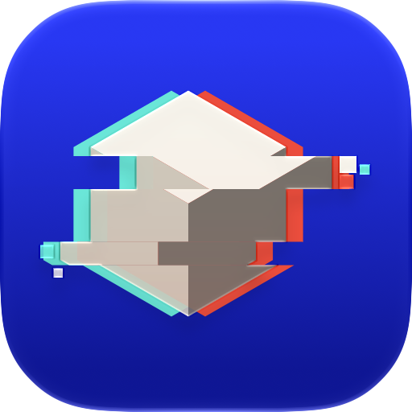
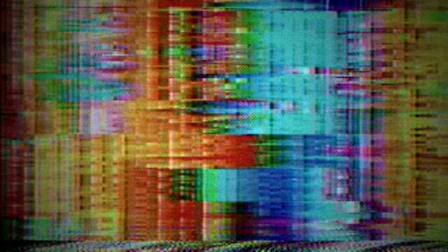
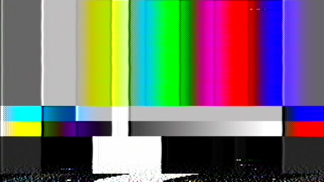
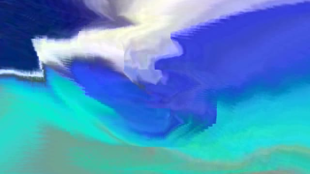
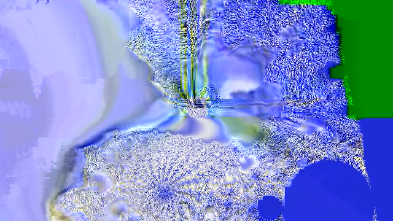
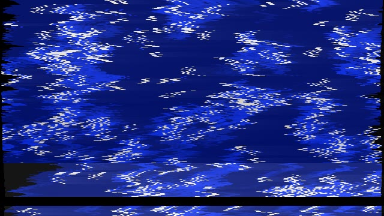
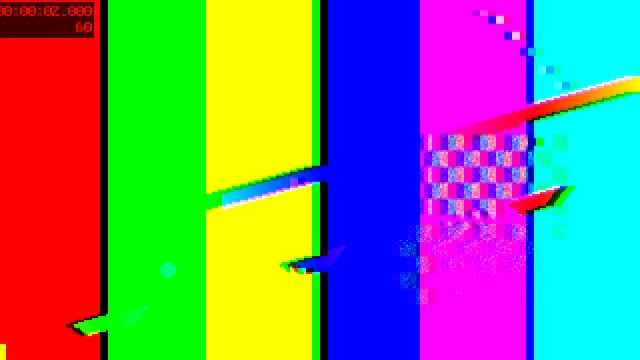
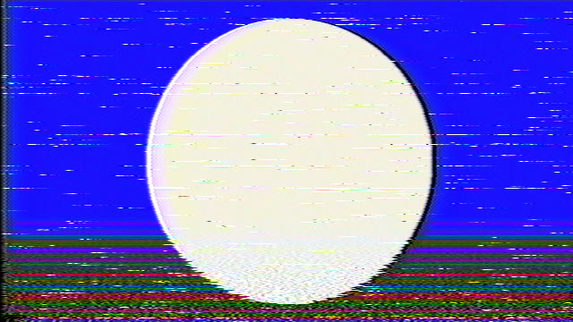

<p align="center">
  
</p>

<h1 align="center">Glitchbox</h1>

<p align="center">Break video on purpose.</p>

<p align="center">
  
</p>

Glitchbox is a Mac app, with an iPhone and iPad version, for wrecking video in
ways that look intentional. Stack datamosh, VHS tape damage, circuit-bent video
hardware, and pixel-level effects into a chain, turn the knobs on each layer, and
watch the result in the built-in player. Every tool it runs ships inside the app,
so there's no Homebrew setup and no FFmpeg fork to compile.

**[Download Glitchbox for macOS](https://github.com/kylegrantlucas/glitchbox/releases/latest)** · Apple silicon, macOS 26 or later

## What it does

### Simple and Advanced

A new install opens in Simple mode: choose a photo or video, tap a look, and the
result renders by itself. Each effect in the look is a card with a row of styles
and a few plain sliders, and Add Effect shows the effects with a picture of what
each does. Advanced mode is the full studio: the library, the layer stack, every
parameter of every layer, and a few specialist effects Simple leaves out. A
card's All Controls opens that effect in Advanced, and Advanced has a Simple
button to come back (⌘1 and ⌘2 on the Mac). Both are views of the same session,
so moving between them never changes your layers or their settings, and
Glitchbox reopens in the mode you left. On iPhone and iPad, swipe down on the
preview to fill the screen, then swipe sideways to flip through the looks.

### Effects in layers

A chain is a stack of layers, and every layer is one effect with its own
controls. Add, reorder, switch off, and remove layers, then render. Work on a
few seconds at a small size while you dial it in, then render the whole clip at
its own resolution. The frame rate can follow the source or be any of the
standard rates, NTSC ones included.

### Only the part you changed renders again

Every layer's output is cached. Nudge a slider on the third layer and Glitchbox
re-renders that layer and the ones below it, while everything above comes
straight from the cache. Layers hand each other lossless video, so stacking them
adds no extra compression in between.

### Export

Export asks three things: video, GIF, or frames; smaller, balanced, or best; and
what size, from the original down to 720p or a 9:16 or 1:1 crop for social posts.
More Options opens the rest in place: H.264 or HEVC, ProRes from 422 LT up to
4444, lossless FFV1, custom frames, in and out points, the clip's own audio or
another track, and the encoder's own settings. Changing export settings never
re-renders the chain, and the frame under the playhead can be saved as a PNG.

### Looks, styles, and your own presets

Glitchbox comes with 70 looks, each a whole chain (tape, film, datamosh, digital,
colour, trippy, sound-driven, and looks that start from a photo), and 161 styles across its
effects, including every preset that ships with bender and every camera move
that ships with burns. Save your own stack as a chain preset and it joins the
looks; save one layer's settings as a preset and it joins that effect's styles.
If you edit a built-in preset, your copy replaces it until you revert it.

### Your own effects

An effect is a small JSON file that declares its parameters and the commands to
run, and Glitchbox builds the controls from it. Write one in the app's plugin
editor or by hand. Steps can call any of the bundled tools, and a step can be a
whole bash script that gets every parameter as a variable.

### A command line, too

The app carries a `glitchbox` command that uses the same engine, effects, and
cache, so a chain you saved in the app renders and exports headless:

```sh
glitchbox export --chain analog-mosh-vhs --format prores -o clip-vhs.mov clip.mp4
```

## The effects

Every clip below is a real Glitchbox render of one of ffmpeg's built-in test
generators.

| | | |
|:---:|:---:|:---:|
| <br>VHS dub (analog pass) | <br>Long smear (MPEG-2 mosh) | <br>Zoom in, zoom out (MV script) |
| <br>Rolling tear (circuit bend) | <br>Smeared test card (pixel smear, RGB split) | <br>Kick drum on the tracking (Reactive VCR) |

Thirty effects come built in.

### Datamosh

MPEG-2 Mosh encodes your clip with forced motion vectors and then smears them,
with an averaging window, separate horizontal and vertical scale, and drift. MV
Script runs the deterministic DD-GlitchAssist scripts on the same encode, and MV
Mangle shuffles MPEG-4 motion vectors from a seed. All three run on
[FFglitch](https://ffglitch.org).

### Analog video

Analog Pass is a full NTSC and VHS simulation from
[ntsc-rs](https://github.com/valadaptive/ntsc-rs), with every one of its settings
exposed. Reactive VCR (Sound Reactive in Simple mode) drives those artifacts from
audio, either the clip's own soundtrack or a file you choose: sliders set how hard
the bass bends the tracking, how far each hit tears the picture, and how much
snow and colour noise the level and the highs add, or you can hand it a mapping
file of your own. VHS Filter is a lighter ffmpeg take
with levels, misregistration, noise, softness, and vignette.

### Circuit bending

Circuit Bend runs your clip through emulated video hardware from
[bender-rs](https://github.com/kylegrantlucas/bender-rs): camera sensor, tape,
frame store, colour encoder, monitor, and feedback loop. Any stage can be broken
the way a stray wire would break it, and you can put the stages in a different
order.

### Pixel effects

RGB Split, Pixel Smear (pixel-sort-style streaks), Pixelate, Bitcrush, Dither,
Trails, Frame Blend, Echo, Mirror, and Datascope come from ffmpeg. Block Glitch,
Row Shift, Plasma Distort, Kaleidoscope, and Vertigo come from frei0r on the Mac;
on iPhone and iPad they are Glitchbox's own versions and look different.

### Screens, film, and colour

CRT Screen puts the picture on a tube with scanlines, a curved face, and glow.
Interlace combs anything that moves and tears rows sideways, and Picture Roll
loses vertical hold. Old Film adds grain, flicker, gate weave, and faded stock,
and Glow blooms the highlights. Duotone prints the picture in two inks, and
False Colour maps brightness onto a thermal-camera scale. All seven are ffmpeg
filter chains.

### Stills in motion

Still Motion turns a photo into a moving clip before any glitch touches it, with
a camera move from [burns](https://github.com/kylegrantlucas/burns-rs). Start from
one of its presets (Ken Burns, pan, roll, breathing, figure eight, handheld shake,
ripple, heat shimmer, or depth moves like orbit and dolly), or set the motion
yourself: start and end framing, zoom swing, parallax height and focus, plus
shake and warp layered on top. Glitchbox suggests it when you open an image. It
always sits at the top of the stack, and the rest of the chain glitches the moving
clip. The depth moves use a depth map you supply, or estimate one on your Mac with
a model that downloads on first use.

## Install

Download `Glitchbox-<version>.dmg` from
[Releases](https://github.com/kylegrantlucas/glitchbox/releases/latest), open it,
and drag Glitchbox to Applications. It needs a Mac with Apple silicon and macOS
26 or later, and takes about 250 MB on disk.

Glitchbox is signed with a Developer ID and notarized by Apple, so it opens like
any other downloaded app.

### iPhone and iPad

The same app runs on iPhone and iPad (iOS and iPadOS 26 or later) with every
effect, rendering on the device. Bring footage in from Photos or Files, and send
exports to Photos, Files, or the share sheet. The iPhone and iPad build links
only LGPL and permissively licensed code (FFmpeg and FFglitch built without
their GPL parts). To build and install it yourself from a clone of this
repository, use Xcode 27 signed into an Apple developer account with the device
connected:

```sh
just ios <device-udid>   # packaging/build.sh ios-app, then ios-install
```

## Built on

Glitchbox runs these projects, all of which ship inside the app:
[FFglitch](https://ffglitch.org) and
[ffglitch-scripts](https://github.com/ramiropolla/ffglitch-scripts),
[ntsc-rs](https://github.com/valadaptive/ntsc-rs),
[bender-rs](https://github.com/kylegrantlucas/bender-rs),
[burns](https://github.com/kylegrantlucas/burns-rs) with
[ONNX Runtime](https://onnxruntime.ai),
[reactive-vcr](https://github.com/kylegrantlucas/reactive-vcr),
[FFmpeg](https://ffmpeg.org),
[frei0r](https://frei0r.dyne.org),
[GStreamer](https://gstreamer.freedesktop.org),
[SoX](https://sourceforge.net/projects/sox/),
[jq](https://jqlang.org), and
[bash](https://www.gnu.org/software/bash/).

## License

Glitchbox is released under the [MIT License](LICENSE). The tools it bundles keep
their own licences; on the Mac, FFmpeg, FFglitch, frei0r, SoX, and bash are GPL.
The About window lists each one with a link to its source, and Help → Third-Party
Licenses opens the full texts. Each release carries
`Glitchbox-<version>-sources.tar`, the complete corresponding source of every
bundled tool.
